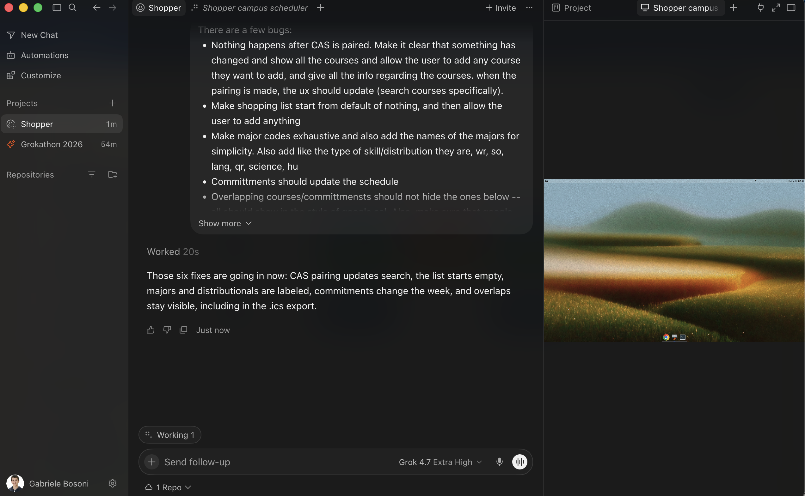

VIDEO: https://drive.google.com/file/d/1_2QUheRIqk0F_jgIcvYAQkO0jT-njlPK/view?usp=sharing

# Shopper

^^ Grokathon proof

Shopper is a Yale shopping-period planner that turns a messy course list into a week you can actually walk. You search courses, add the ones you want, and Shopper builds a schedule that drops time conflicts and any back-to-back pair that takes more than 15 minutes to walk between. Each class shows its time, location, major, and distributional, and selecting one opens the details with a map. Commitments you add sit on the same week, overlaps stay visible side by side, and you can export the whole plan, conflicts included, as an .ics file.

# To Run:

git clone https://github.com/gabriboss1/Shopper.git
cd Shopper
npm ci
npm run dev
